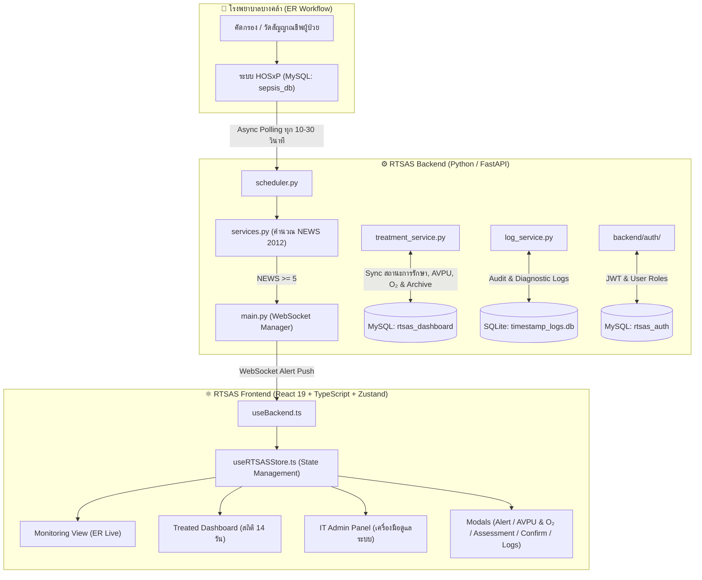

# 📘 RTSAS Codebase Guide — เอกสารอธิบายหน้าที่ของแต่ละไฟล์ในระบบ

> [!NOTE]
> **สถานะระบบและเอกสาร**: ปรับปรุงล่าสุดตามโค้ดต้นฉบับจริง (Production-Ready)  
> ระบบบันทึก **System Logs** และ **Timeline / Assessment Schedule** ได้รับการปรับปรุงแก้ไขเสร็จสมบูรณ์ 100% แล้ว (Zero Clock Drift, SQLite WAL Log Persistence, CLI Diagnostics, Clean Clinical Timeline, Dynamic NEWS Scoring)
> 
> **จุดประสงค์ของเอกสาร**: จัดทำขึ้นเพื่อให้ผู้พัฒนา (Developer) และ AI Coding Assistant สามารถทำความเข้าใจภาพรวมสถาปัตยกรรม, โครงสร้างไฟล์ทั้งหมด, หน้าที่ของแต่ละโมดูลอย่างละเอียด, ตรรกะทางคลินิก (Clinical Business Logic) และข้อกำหนดสำคัญของระบบ **RTSAS (Real-Time Sepsis Alert System)** ได้อย่างถูกต้องและครบถ้วนทันที

---

## 📑 สารบัญ (Table of Contents)
1. [ภาพรวมของระบบและสถาปัตยกรรม (System Overview)](#1-ภาพรวมของระบบและสถาปัตยกรรม-system-overview)
2. [โครงสร้างภาพรวมของโปรเจกต์ (Project Directory Tree)](#2-โครงสร้างภาพรวมของโปรเจกต์-project-directory-tree)
3. [รหัสต้นฉบับฝั่ง Frontend (`src/`)](#3-รหัสต้นฉบับฝั่ง-frontend-src)
   - [3.1 จุดเริ่มต้นและสไตล์หลัก (Entry & Styling)](#31-จุดเริ่มต้นและสไตล์หลัก-entry--styling)
   - [3.2 การจัดการสถานะส่วนกลาง (Zustand Store)](#32-การจัดการสถานะส่วนกลาง-zustand-store)
   - [3.3 Custom React Hooks (`src/hooks/`)](#33-custom-react-hooks-srchooks)
   - [3.4 ชนิดข้อมูลและยูทิลิตี้ (`src/types/` & `src/utils/`)](#34-ชนิดข้อมูลและยูทิลิตี้-srctypes--srcutils)
   - [3.5 หน้าจอหลักของระบบ (`src/pages/`)](#35-หน้าจอหลักของระบบ-srcpages)
   - [3.6 แผงควบคุมคลินิก (`src/components/panels/`)](#36-แผงควบคุมคลินิก-srccomponentspanels)
   - [3.7 หน้าต่างป๊อปอัป (`src/components/modals/`)](#37-หน้าต่างป๊อปอัป-srccomponentsmodals)
   - [3.8 โครงร่างหน้าจอ (`src/components/layout/`)](#38-โครงร่างหน้าจอ-srccomponentslayout)
   - [3.9 คอมโพเนนต์ทั่วไปและการแจ้งเตือน (`src/components/common/`)](#39-คอมโพเนนต์ทั่วไปและการแจ้งเตือน-srccomponentscommon)
   - [3.10 ชุดทดสอบอัตโนมัติฝั่ง Frontend (`src/__tests__/`)](#310-ชุดทดสอบอัตโนมัติฝั่ง-frontend-src__tests__)
4. [รหัสต้นฉบับฝั่ง Backend (`backend/`)](#4-รหัสต้นฉบับฝั่ง-backend-backend)
   - [4.1 จุดเชื่อมต่อหลักและฐานข้อมูล (`main.py`, `config.py`, `database.py`, `database_auth.py`)](#41-จุดเชื่อมต่อหลักและฐานข้อมูล-mainpy-configpy-databasepy-database_authpy)
   - [4.2 การประมวลผลและการจัดเก็บ (`scheduler.py`, `treatment_service.py`, `dashboard_service.py`, `services.py`, `schemas.py`)](#42-การประมวลผลและการจัดเก็บ-schedulerpy-treatment_servicepy-dashboard_servicepy-servicespy-schemaspy)
   - [4.3 ระบบบันทึกเหตุการณ์และเครื่องมือตรวจสอบ (`log_service.py`, `cli_logs.py`, `backend/data/`)](#43-ระบบบันทึกเหตุการณ์และเครื่องมือตรวจสอบ-log_servicepy-cli_logspy-backenddata)
   - [4.4 ระบบยืนยันตัวตนและความปลอดภัย (`backend/auth/`)](#44-ระบบยืนยันตัวตนและความปลอดภัย-backendauth)
   - [4.5 ชุดทดสอบอัตโนมัติฝั่ง Backend (`backend/tests/`)](#45-ชุดทดสอบอัตโนมัติฝั่ง-backend-backendtests)
5. [กระบวนการทำงานหลักทางคลินิก (Key Clinical Workflows)](#5-กระบวนการทำงานหลักทางคลินิก-key-clinical-workflows)
6. [กฎเหล็กและข้อกำหนดสำคัญในการแก้ไขโค้ด (Critical Rules & Constraints)](#6-กฎเหล็กและข้อกำหนดสำคัญในการแก้ไขโค้ด-critical-rules--constraints)
7. [รายการโมดูลที่เสร็จสมบูรณ์ 100% และห้ามแก้ไขสไตล์ (Locked / Finalized Modules)](#7-รายการโมดูลที่เสร็จสมบูรณ์-100-และห้ามแก้ไขสไตล์-locked--finalized-modules)

---

## 1. ภาพรวมของระบบและสถาปัตยกรรม (System Overview)

**RTSAS (Real-Time Sepsis Alert System)** เป็นระบบเฝ้าระวัง แจ้งเตือน และติดตามการรักษาภาวะติดเชื้อในกระแสเลือด (Sepsis) แบบเรียลไทม์ สำหรับห้องอุบัติเหตุและฉุกเฉิน (ER) โรงพยาบาลบางคล้า จังหวัดฉะเชิงเทรา พัฒนาขึ้นเพื่อช่วยให้แพทย์และพยาบาลตรวจพบผู้ป่วยติดเชื้อในกระแสเลือดได้อย่างรวดเร็วตามเกณฑ์ **NEWS 2012 (National Early Warning Score — Royal College of Physicians, 2012)** โดยคงเกณฑ์แจ้งเตือนที่ **5 คะแนนขึ้นไป** และปฏิบัติตามมาตรฐาน Sepsis 1-Hour Bundle ได้อย่างครบถ้วน แม่นยำ และปลอดภัย



### เทคโนโลยีที่ใช้ (Tech Stack)
- **Frontend**: React 19, TypeScript, Vite, Tailwind CSS / Vanilla CSS Tokens, Lucide Icons, Zustand (State Management with LocalStorage persistence & migration v2), Vitest (Automated Unit Tests)
- **Backend**: FastAPI (Python 3.11+), aiomysql (Async MySQL connection pool), SQLAlchemy (Auth DB), WebSockets (Real-time alert push), SQLite WAL (System & server diagnostic logs), Uvicorn
- **ฐานข้อมูล (Multi-Database Architecture)**:
  1. `sepsis_db` (MySQL Port 3306): ข้อมูลผู้ป่วยและสัญญาณชีพจาก HOSxP (`patient_visits`, `opdscreen`, `er_nursing_detail`)
  2. `rtsas_dashboard` (MySQL Port 3306): บันทึกสถานะการรักษาแบบรวมศูนย์ (`patient_treatment_status`, `treated_patient_archive`)
  3. `rtsas_auth` (MySQL Port 3307): จัดการบัญชีผู้ใช้งาน สิทธิ์ และการเข้าสู่ระบบ (`users`)
  4. `timestamp_logs.db` (SQLite WAL): บันทึก Diagnostic Logs, Connection Heartbeats และ Error Logs

---

## 2. โครงสร้างภาพรวมของโปรเจกต์ (Project Directory Tree)

```text
Hospital/
├── CODEBASE_GUIDE.md               # 👈 คู่มือสถาปัตยกรรมและรายละเอียดโค้ดฉบับนี้
├── PROJECT_STRUCTURE.md            # แผนผังโครงสร้างโฟลเดอร์ของโปรเจกต์
├── README.md                       # รายละเอียดการรัน ติดตั้ง และการ Deploy
├── TODO.md                         # บันทึกสถานะงานและการวางแผนงาน
├── docker-compose.yml              # การเปิดระบบ Full Stack ด้วย Docker Compose
├── frontend.Dockerfile             # Dockerfile สำหรับ Frontend (Multi-stage Nginx)
├── nginx.conf                      # Nginx Reverse Proxy จัดเส้นทาง /api, /ws และ Static Files
├── package.json                    # รายการไลบรารี Frontend (React 19, Vitest, Lucide)
├── tsconfig.json                   # การตั้งค่า Master TypeScript
├── tsconfig.app.json               # การตั้งค่า TypeScript Frontend พร้อม Path Alias (@/*)
├── vite.config.ts                  # การตั้งค่า Vite, Ignored Paths และ Path Alias (@/*)
│
├── docs/                           # คู่มือการใช้งานและรายงานการทดสอบ
│   ├── RTSAS_Complete_User_Manual.md # คู่มือผู้ใช้งานฉบับสมบูรณ์ (Markdown)
│   ├── RTSAS_User_Manual.docx      # คู่มือผู้ใช้งานฉบับเอกสาร Word
│   ├── reports/                    # รายงานผลการทดสอบระบบและ QA Audits
│   └── images/                     # ภาพประกอบเอกสารคู่มือ
│
├── backup_data/                    # ไฟล์สำรองข้อมูล JSON และ SQL สำหรับทดสอบ
│
├── src/                            # ⚛️ รหัสต้นฉบับ Frontend
│   ├── App.tsx                     # คอมโพเนนต์หลัก จัดการ Routing และ Layout
│   ├── main.tsx                    # Entry Point ของ React Mount ไปยัง #root
│   ├── index.css                   # Global Styles, CSS Design Tokens & Keyframes
│   │
│   ├── store/                      # 🧠 Zustand Global Store
│   │   └── useRTSASStore.ts        # ศูนย์กลาง State, Checklist, Countdown, Timeline, Migration
│   │
│   ├── hooks/                      # 🪝 Custom React Hooks
│   │   ├── useBackend.ts           # เชื่อมต่อ REST API (/api/patients) และ WebSocket (/ws/alerts)
│   │   └── useTimers.ts            # ตัวจับเวลานับถอยหลัง 60 นาที และระบบแจ้งเตือนรอบ Q15/Q30
│   │
│   ├── types/                      # 🏷️ TypeScript Data Contracts
│   │   └── index.ts                # Interfaces: Patient, VitalSigns, Checklist, Timeline, User
│   │
│   ├── utils/                      # 🛠️ Helper Utilities
│   │   ├── alertSound.ts           # สังเคราะห์เสียงแจ้งเตือนฉุกเฉินด้วย Web Audio API
│   │   ├── errorUtils.ts           # แปลงรหัส Error ทางเทคนิคเป็นภาษาไทยเข้าใจง่าย
│   │   ├── exportReport.ts         # ส่งออกรายงาน CSV (UTF-8 BOM) และสั่งพิมพ์ PDF
│   │   ├── hnMask.ts               # ฟังก์ชันปิดบังข้อมูล HN ตามมาตรฐาน PDPA (HN****XXXX)
│   │   ├── newsCalculator.ts       # การคำนวณคะแนน NEWS 2012 และสร้างรอบการประเมิน
│   │   ├── patientMapper.ts        # แปลงข้อมูลดิบจาก API HOSxP เข้าสู่โมเดล Patient
│   │   └── patientMemory.ts        # ทำความสะอาด Memory และแปลง Timeline เป็น HIS Note
│   │
│   ├── data/                       # 📦 ข้อมูลตั้งต้นระบบ
│   │   └── mockData.ts             # โครงสร้างตัวอย่างและข้อมูลตั้งต้น (ปิด Mock ใน Production)
│   │
│   ├── pages/                      # 📄 หน้าจอหลัก (Full-page views)
│   │   ├── index.ts                # Barrel export รวมหน้าจอ
│   │   ├── TreatedDashboard.tsx    # แดชบอร์ดสรุปเคสที่รักษาแล้ว สถิติ 14 วัน และ Compliance
│   │   ├── AdminPage.tsx           # หน้าจอผู้ดูแลระบบ IT Admin ควบคุมเครื่องมือและ Logs
│   │   ├── LoginPage.tsx           # หน้าจอ Login แบบ Standalone
│   │   └── admin/                  # โมดูลย่อยของหน้า Admin
│   │       ├── index.ts            # Barrel export รวมหน้า Admin
│   │       ├── AdminLayout.tsx     # โครงร่างแผงควบคุม Admin พร้อมระบบแท็บ
│   │       ├── DashboardCleaner.tsx# เครื่องมือล้างข้อมูลทดสอบและแคชระบบ
│   │       ├── PatientSimulator.tsx# เครื่องมือจำลองสร้างเคสผู้ป่วยเข้าสู่ HOSxP
│   │       ├── AlertSimulator.tsx  # เครื่องมือยิง WebSocket Alert จำลอง
│   │       ├── DatabaseFailoverTester.tsx # เครื่องมือทดสอบความทนทานเมื่อฐานข้อมูลหลุด
│   │       └── UserManagement.tsx  # จัดการบัญชีผู้ใช้งาน กำหนดสิทธิ์แพทย์ พยาบาล IT
│   │
│   ├── components/                 # 🧩 UI Components
│   │   ├── index.ts                # Barrel export ระดับ components
│   │   ├── layout/                 # ส่วนโครงสร้างหลักของหน้าจอ
│   │   │   ├── index.ts
│   │   │   ├── Header.tsx          # แถบด้านบน แสดงเวลา ผู้ใช้ และปุ่มสลับหน้าจอ
│   │   │   ├── Sidebar.tsx         # รายชื่อผู้ป่วย ER เรียงตามความเสี่ยงและตัวนับเวลา
│   │   │   └── StatusBar.tsx       # แถบสถานะด้านล่างสุด แสดงสถานะการเชื่อมต่อ
│   │   ├── panels/                 # แผงข้อมูลการรักษาทางคลินิก
│   │   │   ├── index.ts
│   │   │   ├── PatientInfoBar.tsx  # ข้อมูลสรุปผู้ป่วย HN, เพศ, อายุ, สิทธิ, อาการสำคัญ
│   │   │   ├── VitalSignsGrid.tsx  # การ์ดแสดงสัญญาณชีพ 6 ค่า + แถบเลือกการได้รับออกซิเจนเสริม (O₂)
│   │   │   ├── NewsCalculationLogic.tsx # ตารางแจกแจงเกณฑ์คะแนน NEWS 2012 (7 องค์ประกอบ)
│   │   │   ├── ChecklistPanel.tsx  # ขั้นตอนการรักษา Sepsis Bundle (Phase 1–4)
│   │   │   └── TimelinePanel.tsx   # บันทึกประวัติการดูแลรักษาตามเวลาและปุ่มคัดลอก HIS Note
│   │   ├── modals/                 # หน้าต่างป๊อปอัปและ Dialogs
│   │   │   ├── index.ts
│   │   │   ├── AlertModal.tsx      # แจ้งเตือนฉุกเฉินผู้ป่วยวิกฤตรายเดียว (NEWS ≥ 5)
│   │   │   ├── MultiAlertModal.tsx # คิวแจ้งเตือนผู้ป่วยวิกฤตพร้อมกันหลายราย
│   │   │   ├── AVPUAssessmentModal.tsx # ป๊อปอัปประเมิน AVPU (กรณี GCS < 15) และระบุการได้รับออกซิเจนเสริม
│   │   │   ├── AssessmentFormModal.tsx # แบบฟอร์มบันทึกสัญญาณชีพซ้ำ (AVPU + O₂) และปุ่มจบการรักษา
│   │   │   ├── SepsisConfirmModal.tsx  # แพทย์ยืนยันภาวะ Sepsis พร้อมตั้งเวลาเริ่มนับ Bundle
│   │   │   ├── ReminderModal.tsx   # แจ้งเตือนเมื่อถึงรอบประเมินสัญญาณชีพ Q15/Q30
│   │   │   ├── AuthModal.tsx       # เข้าสู่ระบบ / ลงทะเบียนผู้ใช้งาน
│   │   │   ├── GlobalAuthModal.tsx # ตัวเชื่อมต่อ AuthModal กับ Zustand modal state
│   │   │   ├── ExportReportModal.tsx # หน้าต่างเลือกส่งออกรายงานสถิติ (CSV / PDF)
│   │   │   └── SystemLogsModal.tsx # ดู System Logs, ค้นหา, กรองระดับ และปุ่มล้าง Logs
│   │   └── common/                 # คอมโพเนนต์ทั่วไป
│   │       ├── index.ts
│   │       ├── AlertSummaryBanner.tsx # แถบสรุปยอดเตือนผู้ป่วยเสี่ยงสูงที่ยังไม่รับทราบ
│   │       ├── CountdownBanner.tsx # แถบเวลานับถอยหลัง 60 นาที (Sepsis Protocol)
│   │       ├── ErrorBanner.tsx     # แถบเตือนข้อผิดพลาดการเชื่อมต่อพร้อมปุ่ม Retry
│   │       ├── LoadingSkeleton.tsx # โครงร่างแสดงระหว่างรอการโหลดข้อมูล
│   │       └── Toast.tsx           # ระบบแจ้งเตือนผลการทำงานแบบ Floating
│   │
│   └── __tests__/                  # 🧪 Automated Unit & Integration Tests (13 Test Suites)
│       ├── adminModularSuite.test.ts      # ทดสอบเครื่องมือในหน้า Admin ทั้งหมด
│       ├── assessmentSchedule.test.ts     # ทดสอบรอบประเมิน Q15/Q30 และการตั้งเวลา Chaining
│       ├── avpuOxygenWorkflow.test.ts     # ทดสอบตรรกะการประเมิน AVPU (GCS 15 vs <15) และเงื่อนไข O₂ 3 ระดับ
│       ├── centralizedTreatmentSync.test.ts # ทดสอบการ Sync สถานะการรักษาระหว่างไคลเอนต์
│       ├── historicalRecordLock.test.ts   # ทดสอบการล็อกเคสในอดีต ห้ามแก้ไขย้อนหลัง
│       ├── itAdminRole.test.ts            # ทดสอบสิทธิ์การเข้าถึงของผู้ดูแลระบบ IT Admin
│       ├── newsCalculator.test.ts         # ทดสอบความถูกต้องของเกณฑ์คะแนน NEWS 2012
│       ├── patientMemory.test.ts          # ทดสอบการจัดระเบียบ Memory และจัดรูป HIS Note
│       ├── patientMemoryStore.test.ts     # ทดสอบการคุ้มครองเคสกำลังรักษาตอน Clear Memory
│       ├── qa_system_audit.test.ts        # ทดสอบกระบวนการทางคลินิกแบบ End-to-End
│       ├── timeline.test.ts               # ทดสอบ Audit Trail, การบันทึก Vitals และการคัดลอก
│       ├── treatedDashboard.test.ts       # ทดสอบการคำนวณ KPI และสถิติ 14 วัน
│       └── treatmentCompletion.test.ts    # ทดสอบการสิ้นสุดการรักษาและส่งเข้า Archive
│
└── backend/                        # 🐍 รหัสต้นฉบับ Backend (FastAPI + Python 3.11+)
    ├── main.py                     # API Routes, WebSocket Server, Lifespan Handler
    ├── config.py                   # ตัวแปรการตั้งค่าระบบ อ่านค่าจาก Environment (.env)
    ├── database.py                 # Async MySQL Connection Pools (sepsis_db, rtsas_dashboard)
    ├── database_auth.py            # SQLAlchemy Engine สำหรับจัดการฐานข้อมูล rtsas_auth
    ├── scheduler.py                # Background Polling ดึงข้อมูล HOSxP และดัน Alert
    ├── treatment_service.py        # จัดการสถานะการรักษาแบบ Centralized และจัดเก็บ Archive
    ├── dashboard_service.py        # คำนวณและสรุปสถิติผู้ป่วยประจำวันย้อนหลัง 14 วัน
    ├── services.py                 # คิวรีฐานข้อมูล HOSxP และคำนวณคะแนน NEWS 2012
    ├── schemas.py                  # Pydantic Schemas ของข้อมูลผู้ป่วย, Vitals, NEWS Breakdown
    ├── log_service.py              # บันทึก System Logs และสถิติการเชื่อมต่อลง SQLite WAL
    ├── cli_logs.py                 # เครื่องมือ CLI สำหรับดู Log, สถานะ DB และ Stream บน Terminal
    ├── Dockerfile                  # คอนเทนเนอร์สำหรับรัน FastAPI Backend
    ├── entrypoint.sh               # สคริปต์ตรวจสอบความพร้อมของฐานข้อมูลก่อนเปิดระบบ
    ├── requirements.txt            # รายการไลบรารี Python (fastapi, aiomysql, sqlalchemy, etc.)
    │
    ├── auth/                       # 🔐 ระบบยืนยันตัวตนและความปลอดภัย
    │   ├── __init__.py
    │   ├── models.py               # SQLAlchemy User Model (id, username, password, role)
    │   ├── router.py               # API Endpoints (/auth/login, /auth/register, /auth/me)
    │   ├── schemas.py              # Pydantic Schemas สำหรับ Auth Request / Response
    │   └── service.py              # การแฮชรหัสผ่าน bcrypt และสร้าง/ตรวจสอบ JWT Token
    │
    ├── data/                       # 📁 ที่เก็บฐานข้อมูลท้องถิ่นและไฟล์สถานะ
    │   ├── timestamp_logs.db       # ฐานข้อมูล SQLite สำหรับเก็บ Diagnostic & System Logs
    │   ├── seen_vitals.json        # บันทึก Vitals ID ล่าสุดที่ตรวจพบ ป้องกัน Alert ซ้ำ
    │   └── patient_snapshots.json  # สำเนาข้อมูลผู้ป่วยสำหรับกู้คืนกรณีฉุกเฉิน
    │
    └── tests/                      # 🧪 Python Unit Tests (unittest)
        ├── __init__.py
        ├── test_api_endpoints.py   # ทดสอบ REST API Endpoints ของระบบ
        ├── test_auth.py            # ทดสอบระบบ Authentication, JWT และ Role Verification
        ├── test_dashboard_api.py   # ทดสอบ API แดชบอร์ดสรุปสถิติประจำวัน
        ├── test_patient_logging.py # ทดสอบการบันทึก Log และ SQLite WAL DB
        ├── test_scheduler_cache.py # ทดสอบ Cache และ Background Polling
        ├── test_services.py        # ทดสอบการคิวรีฐานข้อมูล HOSxP และการคำนวณ NEWS
        ├── test_simulator_api.py   # ทดสอบ API เครื่องมือจำลองผู้ป่วยและ Alert
        └── test_treatment_service.py # ทดสอบ Centralized Treatment Status Lifecycle
```

---

## 3. รหัสต้นฉบับฝั่ง Frontend (`src/`)

### 3.1 จุดเริ่มต้นและสไตล์หลัก (Entry & Styling)

- **[`src/main.tsx`](file:///Users/phatchara/Desktop/Hospital/src/main.tsx)**  
  จุดเริ่มต้นการ Mount React Application เข้ากับ DOM Element `#root` ใน `index.html` พร้อมเรียกใช้ `index.css` เพื่อตั้งค่าระบบสีและฟอนต์มาตรฐานของโรงพยาบาล
- **[`src/App.tsx`](file:///Users/phatchara/Desktop/Hospital/src/App.tsx)**  
  คอมโพเนนต์หลักที่ทำหน้าที่เป็น View Router สลับหน้าจอระหว่าง:
  1. `monitoring`: หน้าจอหลักสำหรับติดตามและดูแลผู้ป่วยสดใน ER (Patient Info, Vitals, Checklist, Timeline)
  2. `treated_dashboard`: หน้าจอแดชบอร์ดสรุปสถิติผู้ป่วยที่ผ่านการรักษาแล้ว (14 วันย้อนหลัง)
  3. `admin`: หน้าจอผู้ดูแลระบบ IT Admin พร้อมแท็บเครื่องมือครบครัน
  4. `login`: หน้าต่างเข้าสู่ระบบแบบเต็มจอ  
  นอกจากนี้ยังทำหน้าที่เรียกใช้ Custom Hooks (`usePatientData`, `useSepsisTimers`) และเรนเดอร์ Modals ส่วนกลางทั้งหมด
- **[`src/index.css`](file:///Users/phatchara/Desktop/Hospital/src/index.css)**  
  กำหนด CSS Design Tokens, Font Family รองรับภาษาไทยสมบูรณ์แบบ, แอนิเมชันสถานะฉุกเฉิน (`animate-slideUp`, `animate-pulse-btn`, `animate-fade-in`, `urgent-flash`) และการปรับแต่ง Scrollbar

---

### 3.2 การจัดการสถานะส่วนกลาง (Zustand Store)

- **[`src/store/useRTSASStore.ts`](file:///Users/phatchara/Desktop/Hospital/src/store/useRTSASStore.ts)** ⭐ *(ศูนย์กลางการจัดการ State ทั้งหมดของ Frontend)*  
  ใช้ Zustand จัดเก็บสถานะแบบ Single Source of Truth พร้อมบันทึกลง `localStorage` (`rtsas-storage`) ภายใต้ Version 2 Migration:
  - **Zero Mock State**: เริ่มต้นด้วย `patients: []` โดยมีระบบตรวจจับและคัดกรองข้อมูลจำลองเก่า (`MOCK_IDS`) ออกจากการ Rehydrate เสมอ เพื่อให้มั่นใจว่าใช้เฉพาะข้อมูลจริงจาก HOSxP
  - **Per-Patient State Isolation (`patientData[id]`)**: แยกข้อมูล Checklist, Countdown Timer, Assessment Schedule, Timeline ออกเป็นรายบุคคลอย่างเด็ดขาด ป้องกันข้อมูลรั่วไหลข้ามเคส
  - **Checklist Engine**: จัดการขั้นตอนการรักษา Phase 1–4, การบันทึกเวลา, การข้าม (Skip), และการปลดล็อกตามลำดับ (Sequential Unlocking)
  - **Zero Clock Drift Chaining**: ในฟังก์ชัน `completeAssessment` คำนวณเวลาของรอบถัดไป (`nextScheduledTime`) จากเวลาที่บันทึกจริง (`completedAt`) เสมอ ป้องกันการคลาดเคลื่อนของตัวนับเวลา
  - **Clean Clinical Timeline**: ปรับรูปแบบข้อความใน Timeline ให้กระชับ สวยงาม แสดงสัญญาณชีพครบ 6 ค่า และคะแนน NEWS อย่างแม่นยำ พร้อมระบายสีแถบตามความเสี่ยงจริง
  - **Historical Patient Lock (`isHistoricalPatient`)**: ฟังก์ชันตรวจสอบและล็อกเคสในอดีต ห้ามแก้ไข Checklist หรือตารางประเมินย้อนหลัง เพื่อความถูกต้องทางเวชระเบียน
  - **Memory Cleanup (`clearInactivePatientsMemory`)**: ทำความสะอาดหน่วยความจำ ลบเคสเก่าที่ไม่เกี่ยวข้อง โดยคุ้มครองเคสที่กำลังรักษาอยู่เสมอ

---

### 3.3 Custom React Hooks (`src/hooks/`)

- **[`src/hooks/useBackend.ts`](file:///Users/phatchara/Desktop/Hospital/src/hooks/useBackend.ts)**  
  - ดึงข้อมูลรายชื่อผู้ป่วยจาก Backend (`GET /api/patients`) ทุกรอบ Polling (ค่าเริ่มต้น 60 วินาที หรือกดดึงข้อมูลทันที)
  - เชื่อมต่อ WebSocket (`/ws/alerts`) เพื่อรับ Event แจ้งเตือนฉุกเฉินแบบ Real-time ทันทีที่พบผู้ป่วยเสี่ยงสูงรายใหม่
  - จัดการ Reconnection อัตโนมัติเมื่อเครือข่ายหลุด และนำข้อมูล Alert เข้าสู่คิวแจ้งเตือน
  - ตัด Fallback Mock Data ออกอย่างสมบูรณ์เพื่อป้องกันไม่ให้ข้อมูลจำลองเข้ามาแทรกแซงการทำงานจริง
- **[`src/hooks/useTimers.ts`](file:///Users/phatchara/Desktop/Hospital/src/hooks/useTimers.ts)**  
  - นับถอยหลัง Sepsis 60 นาที (1-Hour Bundle Countdown) ทุก 1 วินาที
  - ตรวจสอบรอบเวลาประเมินสัญญาณชีพซ้ำ (Q15 4 ครั้งแรก แล้วตามด้วย Q30) และเรียกเปิด `ReminderModal` แจ้งเตือนพยาบาลเมื่อถึงเวลาประเมินจริง

---

### 3.4 ชนิดข้อมูลและยูทิลิตี้ (`src/types/` & `src/utils/`)

- **[`src/types/index.ts`](file:///Users/phatchara/Desktop/Hospital/src/types/index.ts)**  
  สัญญาข้อมูล (Data Contracts) ทั้งหมด: `Patient`, `VitalSigns` (รวม `diastolicBP`, `avpu`, `oxygenSupplementation`), `NEWSResult`, `ChecklistItem`, `AssessmentScheduleEntry`, `TimelineEvent`, `User`, `AVPU`, `OxygenSupplementation`, `TreatmentStatus`
- **[`src/utils/newsCalculator.ts`](file:///Users/phatchara/Desktop/Hospital/src/utils/newsCalculator.ts)**  
  ฟังก์ชันคำนวณคะแนน **NEWS 2012** ตามเกณฑ์ Royal College of Physicians (UK) ครบ 7 พารามิเตอร์ (`RR`, `SpO₂`, `Supplemental O₂`, `Temp`, `SBP`, `HR`, `AVPU`) รองรับสถานะรอการประเมิน (`Incomplete`) สำหรับ `AVPU` (เมื่อ `GCS < 15`) และ `Supplemental O₂` (เกณฑ์ 3 ระดับ: `0–2` ไม่เตือน, `3–4` รอระบุ O₂ ก่อนสรุปผล, `≥ 5` แจ้งเตือนทันที) พร้อมระบบสร้างรอบการประเมินอัตโนมัติ
- **[`src/utils/hnMask.ts`](file:///Users/phatchara/Desktop/Hospital/src/utils/hnMask.ts)**  
  ฟังก์ชันปิดบังข้อมูล HN ตามมาตรฐาน PDPA โดยแสดงเฉพาะ 4 หลักท้าย (เช่น `HN****8675`)
- **[`src/utils/alertSound.ts`](file:///Users/phatchara/Desktop/Hospital/src/utils/alertSound.ts)**  
  สังเคราะห์เสียงแจ้งเตือนฉุกเฉินด้วย Web Audio API ทำงานได้ทันทีแบบออฟไลน์โดยไม่ต้องโหลดไฟล์เสียงภายนอก
- **[`src/utils/exportReport.ts`](file:///Users/phatchara/Desktop/Hospital/src/utils/exportReport.ts)**  
  สร้างและดาวน์โหลดรายงานการรักษาในรูปแบบ CSV (พร้อม UTF-8 BOM รองรับภาษาไทยใน Microsoft Excel บน Windows) และพิมพ์สรุป PDF
- **[`src/utils/patientMemory.ts`](file:///Users/phatchara/Desktop/Hospital/src/utils/patientMemory.ts)**  
  จัดการหน่วยความจำของ Store และแปลงประวัติ Timeline เป็นข้อความสำหรับคัดลอกลงระบบเวชระเบียน HIS Note
- **[`src/utils/patientMapper.ts`](file:///Users/phatchara/Desktop/Hospital/src/utils/patientMapper.ts)**  
  แปลงข้อมูลดิบจาก API HOSxP ให้อยู่ในโครงสร้าง `Patient` ที่พร้อมใช้งานในหน้าจอ
- **[`src/utils/errorUtils.ts`](file:///Users/phatchara/Desktop/Hospital/src/utils/errorUtils.ts)**  
  แปลง Technical Error Strings ให้เป็นข้อความแจ้งเตือนภาษาไทยที่เข้าใจง่ายสำหรับเจ้าหน้าที่หน้างาน

---

### 3.5 หน้าจอหลักของระบบ (`src/pages/`)

- **[`src/pages/TreatedDashboard.tsx`](file:///Users/phatchara/Desktop/Hospital/src/pages/TreatedDashboard.tsx)**  
  หน้าจอแดชบอร์ดสรุปสถิติผู้ป่วยที่ผ่านการรักษาแล้ว (Sepsis Bundle Done หรือ Rule Out):
  - แสดง KPI Cards: เคสทั้งหมด, เสี่ยง Sepsis, รักษาสำเร็จ (Bundle Done), Compliance Rate
  - ตารางเปรียบเทียบสถิติรายวันย้อนหลัง 14 วัน
  - ตารางรายชื่อเคสที่รักษาแล้ว (Masked HN ตาม PDPA) พร้อมปุ่มคลิกดูประวัติการรักษา (Timeline Modal แบบ Read-only)
- **[`src/pages/AdminPage.tsx`](file:///Users/phatchara/Desktop/Hospital/src/pages/AdminPage.tsx)**  
  หน้าหลักสำหรับผู้ดูแลระบบ IT และหัวหน้าเวร จัดการแท็บเครื่องมือต่างๆ, ดู System Logs และสั่งล้างข้อมูลอย่างปลอดภัย
- **[`src/pages/LoginPage.tsx`](file:///Users/phatchara/Desktop/Hospital/src/pages/LoginPage.tsx)**  
  หน้าจอลงชื่อเข้าใช้งานแบบ Standalone พร้อมระบบสลับโหมดเข้าสู่ระบบ / ลงทะเบียน
- **[`src/pages/admin/AdminLayout.tsx`](file:///Users/phatchara/Desktop/Hospital/src/pages/admin/AdminLayout.tsx)**  
  โครงร่างหน้าจอ Admin จัดสรรแถบเมนู แท็บเปลี่ยนหน้าย่อย และปุ่มกลับสู่หน้าห้องฉุกเฉิน
- **[`src/pages/admin/DashboardCleaner.tsx`](file:///Users/phatchara/Desktop/Hospital/src/pages/admin/DashboardCleaner.tsx)**  
  เครื่องมือจัดการและล้างข้อมูลจำลอง: เคลียร์เคสทดสอบออกจาก Treated Dashboard, คืนหน่วยความจำ RAM และรีเซ็ตระบบ
- **[`src/pages/admin/PatientSimulator.tsx`](file:///Users/phatchara/Desktop/Hospital/src/pages/admin/PatientSimulator.tsx)**  
  เครื่องมือจำลองสร้างผู้ป่วยใหม่อัตโนมัติ เพื่อทดสอบการรับเคสเข้าสู่ห้องฉุกเฉิน
- **[`src/pages/admin/AlertSimulator.tsx`](file:///Users/phatchara/Desktop/Hospital/src/pages/admin/AlertSimulator.tsx)**  
  เครื่องมือทดสอบยิง Alert จำลองแบบ Real-time ผ่าน WebSocket
- **[`src/pages/admin/DatabaseFailoverTester.tsx`](file:///Users/phatchara/Desktop/Hospital/src/pages/admin/DatabaseFailoverTester.tsx)**  
  เครื่องมือทดสอบการตัดการเชื่อมต่อ MySQL เพื่อตรวจสอบความทนทาน (Resilience)
- **[`src/pages/admin/UserManagement.tsx`](file:///Users/phatchara/Desktop/Hospital/src/pages/admin/UserManagement.tsx)**  
  จัดการบัญชีผู้ใช้งานระบบ กำหนดสิทธิ์บทบาท (แพทย์, พยาบาล, IT Admin)
- **[`src/pages/index.ts`](file:///Users/phatchara/Desktop/Hospital/src/pages/index.ts)** & **[`src/pages/admin/index.ts`](file:///Users/phatchara/Desktop/Hospital/src/pages/admin/index.ts)**  
  Barrel exports สำหรับเรียกใช้งานหน้าจอได้อย่างเป็นระเบียบ

---

### 3.6 แผงควบคุมคลินิก (`src/components/panels/`)

- **[`src/components/panels/PatientInfoBar.tsx`](file:///Users/phatchara/Desktop/Hospital/src/components/panels/PatientInfoBar.tsx)**  
  แถบแสดงข้อมูลสรุปของผู้ป่วยที่กำลังเลือกดู: Masked HN, เพศ, อายุ, สิทธิการรักษา, อาการสำคัญ (Chief Complaint) และเวลาที่อยู่ใน ER
- **[`src/components/panels/VitalSignsGrid.tsx`](file:///Users/phatchara/Desktop/Hospital/src/components/panels/VitalSignsGrid.tsx)**  
  การ์ดแสดงสัญญาณชีพ 6 ค่า (`RR`, `SpO₂`, `Temp`, `SBP/DBP`, `HR`, `GCS/AVPU` ซึ่งคิด `A = 0` อัตโนมัติเมื่อ `GCS = 15` และขึ้นปุ่มประเมินเมื่อ `GCS < 15`) พร้อมแถบพารามิเตอร์ที่ 7 `Supplemental O₂` (แสดง `ยังไม่ระบุ` หากยังไม่ได้ประเมิน หรือสลับ `Room Air (0)` / `On O₂ (+2)` ได้ทันที) ตามเกณฑ์ NEWS 2012
- **[`src/components/panels/NewsCalculationLogic.tsx`](file:///Users/phatchara/Desktop/Hospital/src/components/panels/NewsCalculationLogic.tsx)**  
  แผงแจกแจงเกณฑ์คะแนน **NEWS 2012 (7 พารามิเตอร์)** แบบละเอียด แสดงค่าจริงเทียบกับช่วงคะแนน (รวมแถว `Supplemental O₂` และ `AVPU`) ให้ทีมแพทย์ตรวจสอบที่มาของความเสี่ยงได้อย่างโปร่งใส
- **[`src/components/panels/ChecklistPanel.tsx`](file:///Users/phatchara/Desktop/Hospital/src/components/panels/ChecklistPanel.tsx)**  
  แผงขั้นตอนการรักษา Sepsis Bundle แบ่งเป็น 4 ระยะ:
  - **Phase 1**: วินิจฉัยเบื้องต้น (Hemoculture, CBC, Lactate)
  - **Phase 2**: แพทย์ยืนยันการรักษา (Doctor Clinical Confirmation หรือ Rule Out แบบคลิกเดียวจบ)
  - **Phase 3**: การให้การรักษาเร่งด่วนใน 1 ชั่วโมง (Antibiotic, IV Fluid, Foley Cath)
  - **Phase 4**: ตารางประเมินสัญญาณชีพซ้ำ (Q15 4 ครั้งแรก จากนั้น Q30) **แสดงผลค่าสัญญาณชีพที่บันทึกจริงในแต่ละรอบแบบ Inline Table อย่างสวยงาม**
- **[`src/components/panels/TimelinePanel.tsx`](file:///Users/phatchara/Desktop/Hospital/src/components/panels/TimelinePanel.tsx)**  
  บันทึกประวัติการดูแลรักษาทางการแพทย์ตามลำดับเวลา (Timestamp Audit Trail) พร้อมปุ่มคัดลอกข้อความนำไปวางในระบบเวชระเบียนโรงพยาบาล (HIS Note Format)
- **[`src/components/panels/index.ts`](file:///Users/phatchara/Desktop/Hospital/src/components/panels/index.ts)**  
  Barrel export รวม Clinical Panels

---

### 3.7 หน้าต่างป๊อปอัป (`src/components/modals/`)

- **[`src/components/modals/AssessmentFormModal.tsx`](file:///Users/phatchara/Desktop/Hospital/src/components/modals/AssessmentFormModal.tsx)** ⭐ *(สำคัญมาก)*  
  หน้าต่างฟอร์มบันทึกสัญญาณชีพซ้ำใน Phase 4 ตามเกณฑ์ **NEWS 2012**:
  - ช่องกรอกสัญญาณชีพตัวเลข 5 ค่า (`RR`, `SpO₂`, `SBP/DBP`, `HR`, `Temp`) พร้อมปุ่มเลือก **ระดับความรู้สึกตัว `AVPU` (`A`, `V`, `P`, `U`)** และ **การให้ออกซิเจน `Supplemental O₂` (`ไม่ได้รับ O₂ (0)` / `ได้รับ O₂ (+2)`)** โดยตรงครบ 7 พารามิเตอร์ (ไม่ใช้การกรอก GCS แปลงค่าอัตโนมัติ)
  - **คำนวณค่า `MAP (Mean Arterial Pressure)` อัตโนมัติ**: ทันทีที่กรอก `SBP` และ `DBP` ระบบจะคำนวณ $\text{MAP} = \text{round}\left(\frac{\text{SBP} + 2\times\text{DBP}}{3}\right)$ อัตโนมัติ พร้อมแสดงป้ายสถานะเทียบเกณฑ์เป้าหมาย Sepsis ($\ge 65\text{ mmHg}$ ปกติ / $< 65\text{ mmHg}$ ต่ำกว่าเกณฑ์) และแสดงผลในตารางประเมินซ้ำ Phase 4 (`ChecklistPanel.tsx`)
  - **ระบบแจ้งเตือนข้อมูลไม่ครบ**: มีแถบเตือนสีเหลือง `⚠️ ยังกรอกข้อมูลไม่ครบถ้วน (X/7 รายการ)` บังคับระบุครบทั้ง 7 พารามิเตอร์ก่อนบันทึก
  - **ปุ่ม `💾 บันทึกการประเมิน`**: บันทึกเฉพาะรอบนั้นตามปกติ พร้อมบันทึกค่า `AVPU`, `O₂`, และ `MAP` ลงใน Timeline Audit Trail อย่างชัดเจน
  - **ปุ่ม `✅ รักษาเสร็จแล้ว`**: กดยืนยันสองขั้นตอน (`⚠️ ยืนยันเสร็จสิ้น`) จะทำการ **Timestamp จบการรักษาที่รอบปัจจุบันทันที** (รอบนี้จะขึ้น `✅ เสร็จตรงนี้` และรอบถัดไปเป็น `— ยกเลิก`), บันทึกสัญญาณชีพและคะแนน NEWS 2012 สุดท้าย, หยุดตัวนับเวลา Countdown และส่งเคสเข้า Treated Dashboard ทันที
- **[`src/components/modals/AVPUAssessmentModal.tsx`](file:///Users/phatchara/Desktop/Hospital/src/components/modals/AVPUAssessmentModal.tsx)** ⭐  
  หน้าต่างป๊อปอัปอัจฉริยะสำหรับประเมินพารามิเตอร์ที่ไม่มีในฐานข้อมูล HOSxP (`AVPU` และ `Supplemental O₂`):
  - แสดงส่วนเลือก `AVPU` (`A = 0`, `V/P/U = +3`) เฉพาะเมื่อผู้ป่วยมี `GCS < 15` และยังไม่ได้ประเมิน (กรณี `GCS = 15` ระบบคิดเป็น `A = 0` อัตโนมัติทันที)
  - แสดงส่วนเลือก `Supplemental O₂` (`ไม่ได้รับออกซิเจน = 0`, `ได้รับออกซิเจน = +2`) เมื่อยังไม่ได้ระบุสถานะออกซิเจน (โดยระบบจะเด้งถามอัตโนมัติในกลุ่มคะแนนเบื้องต้น `3–4` คะแนน ซึ่งหากได้รับออกซิเจน `+2` จะทำให้คะแนนรวมเป็น `5–6` คะแนนและเข้าเกณฑ์แจ้งเตือน Sepsis ทันที)
- **[`src/components/modals/SepsisConfirmModal.tsx`](file:///Users/phatchara/Desktop/Hospital/src/components/modals/SepsisConfirmModal.tsx)** ⭐  
  หน้าต่างสำหรับแพทย์ยืนยันภาวะติดเชื้อ Sepsis:
  - รองรับการระบุเวลาที่แพทย์ยืนยันจริง (Custom Timestamp)
  - มีระบบคำนวณและแสดงเวลาที่ผ่านไป (Elapsed) และเวลาที่เหลือใน 1 ชั่วโมงแบบ Real-time ก่อนกดยืนยัน
- **[`src/components/modals/AlertModal.tsx`](file:///Users/phatchara/Desktop/Hospital/src/components/modals/AlertModal.tsx)**  
  หน้าต่างแจ้งเตือนฉุกเฉินสีแดง/ส้มเมื่อมีผู้ป่วยเสี่ยงสูง (`NEWS ≥ 5`) แสดงข้อมูลสรุปและปุ่มรับทราบ (Acknowledge)
- **[`src/components/modals/MultiAlertModal.tsx`](file:///Users/phatchara/Desktop/Hospital/src/components/modals/MultiAlertModal.tsx)**  
  หน้าต่างคิวแจ้งเตือนผู้ป่วยวิกฤตพร้อมกันหลายราย ให้เจ้าหน้าที่ไล่รับทราบทีละรายอย่างปลอดภัย
- **[`src/components/modals/ReminderModal.tsx`](file:///Users/phatchara/Desktop/Hospital/src/components/modals/ReminderModal.tsx)**  
  หน้าต่างเตือนเมื่อถึงรอบเวลาประเมินสัญญาณชีพซ้ำ (Q15 / Q30) พร้อมปุ่มเลื่อนเตือน (Snooze 5 นาที) หรือกดบันทึกทันที
- **[`src/components/modals/SystemLogsModal.tsx`](file:///Users/phatchara/Desktop/Hospital/src/components/modals/SystemLogsModal.tsx)** ⭐  
  หน้าต่างดูบันทึกเหตุการณ์และ Log การทำงานของระบบ:
  - กรองระดับความรุนแรง (ALL, NOTE, WARN, ERROR)
  - ค้นหาข้อความ Log แบบเรียลไทม์
  - ปุ่ม `📋 คัดลอก Log`
  - **ปุ่ม `🗑️ ล้าง Logs`**: สั่งล้าง Diagnostic Logs ทั้งหมดผ่าน API พร้อมกล่องข้อความยืนยัน
- **[`src/components/modals/ExportReportModal.tsx`](file:///Users/phatchara/Desktop/Hospital/src/components/modals/ExportReportModal.tsx)**  
  หน้าต่างเลือกส่งออกรายงานสถิติประจำวัน (CSV / พิมพ์สรุป PDF)
- **[`src/components/modals/AuthModal.tsx`](file:///Users/phatchara/Desktop/Hospital/src/components/modals/AuthModal.tsx)**  
  หน้าต่างเข้าสู่ระบบ / ลงทะเบียนผู้ใช้งาน
- **[`src/components/modals/GlobalAuthModal.tsx`](file:///Users/phatchara/Desktop/Hospital/src/components/modals/GlobalAuthModal.tsx)**  
  คอมโพเนนต์เชื่อมโยง `AuthModal` เข้ากับ Zustand Store เพื่อให้เปิดได้จากทุกจุดในระบบ
- **[`src/components/modals/index.ts`](file:///Users/phatchara/Desktop/Hospital/src/components/modals/index.ts)**  
  Barrel export รวม Modals ทั้งหมด

---

### 3.8 โครงร่างหน้าจอ (`src/components/layout/`)

- **[`src/components/layout/Header.tsx`](file:///Users/phatchara/Desktop/Hospital/src/components/layout/Header.tsx)**  
  ส่วนหัวของระบบ แสดงชื่อโรงพยาบาล, นาฬิกาเรียลไทม์, ผู้ใช้งานปัจจุบัน, ปุ่มสลับไปยัง Treated Dashboard, ปุ่ม Admin และปุ่มเปิด Modal ต่าง ๆ
- **[`src/components/layout/Sidebar.tsx`](file:///Users/phatchara/Desktop/Hospital/src/components/layout/Sidebar.tsx)**  
  แถบด้านซ้าย แสดงคิวผู้ป่วยใน ER:
  - แยกหมวดหมู่: ผู้ป่วยกำลังรักษา (Active Sepsis), รอการประเมิน (Monitoring), ผู้ป่วยที่รักษาเสร็จแล้ว (Treated/Ruled Out)
  - แสดงคะแนน NEWS, เวลาที่อยู่ใน ER, และตัวนับเวลานับถอยหลังของแต่ละเคส
- **[`src/components/layout/StatusBar.tsx`](file:///Users/phatchara/Desktop/Hospital/src/components/layout/StatusBar.tsx)**  
  แถบสถานะด้านล่างสุดของจอ: แสดงสถานะการเชื่อมต่อเครือข่าย, สถานะ HOSxP Sync และเวอร์ชันของระบบ
- **[`src/components/layout/index.ts`](file:///Users/phatchara/Desktop/Hospital/src/components/layout/index.ts)**  
  Barrel export รวม Layout components

---

### 3.9 คอมโพเนนต์ทั่วไปและการแจ้งเตือน (`src/components/common/`)

- **[`src/components/common/Toast.tsx`](file:///Users/phatchara/Desktop/Hospital/src/components/common/Toast.tsx)**  
  ระบบแจ้งเตือน Toast ลอยมุมขวาบน มีฟังก์ชัน `showToast(msg, type)` สำหรับข้อความสำเร็จหรือข้อผิดพลาด
- **[`src/components/common/CountdownBanner.tsx`](file:///Users/phatchara/Desktop/Hospital/src/components/common/CountdownBanner.tsx)**  
  แถบสีแจ้งเตือนเวลานับถอยหลัง 60 นาที (1-Hour Sepsis Protocol) แสดงอยู่ด้านบนของแผง Checklist
- **[`src/components/common/AlertSummaryBanner.tsx`](file:///Users/phatchara/Desktop/Hospital/src/components/common/AlertSummaryBanner.tsx)**  
  แถบสรุปยอดเตือนสีแดงด้านบนสุดเมื่อมีผู้ป่วยเสี่ยงสูงที่ยังไม่ได้รับทราบ
- **[`src/components/common/LoadingSkeleton.tsx`](file:///Users/phatchara/Desktop/Hospital/src/components/common/LoadingSkeleton.tsx)**  
  โครงร่างแสดงระหว่างที่ระบบกำลังโหลดข้อมูล
- **[`src/components/common/ErrorBanner.tsx`](file:///Users/phatchara/Desktop/Hospital/src/components/common/ErrorBanner.tsx)**  
  แถบแจ้งเตือนเมื่อเกิดข้อผิดพลาดในการเชื่อมต่อฐานข้อมูล พร้อมปุ่ม Retry
- **[`src/components/common/index.ts`](file:///Users/phatchara/Desktop/Hospital/src/components/common/index.ts)** & **[`src/components/index.ts`](file:///Users/phatchara/Desktop/Hospital/src/components/index.ts)**  
  Barrel exports รวม Common components

---

### 3.10 ชุดทดสอบอัตโนมัติฝั่ง Frontend (`src/__tests__/`)

| ไฟล์ชุดทดสอบ | ขอบเขตการทดสอบ (Test Scope) |
|---|---|
| **[`src/__tests__/adminModularSuite.test.ts`](file:///Users/phatchara/Desktop/Hospital/src/__tests__/adminModularSuite.test.ts)** | ทดสอบเครื่องมือ IT Admin ครบทุกฟังก์ชัน (Dashboard Cleaner, Simulators, Failover, User Management) |
| **[`src/__tests__/assessmentSchedule.test.ts`](file:///Users/phatchara/Desktop/Hospital/src/__tests__/assessmentSchedule.test.ts)** | ทดสอบรอบการประเมิน Q15 (รอบ 1-4) และ Q30 (รอบ 5 เป็นต้นไป) และการ Chaining เวลาแบบแม่นยำ |
| **[`src/__tests__/avpuOxygenWorkflow.test.ts`](file:///Users/phatchara/Desktop/Hospital/src/__tests__/avpuOxygenWorkflow.test.ts)** | ทดสอบเวิร์กโฟลว์ NEWS 2012 สำหรับการประเมิน AVPU (`GCS = 15` คิดเป็น `A = 0` ทันที, `GCS < 15` รอประเมิน) และเกณฑ์ Supplemental O₂ 3 ระดับ (`0–2`, `3–4`, `≥ 5`) |
| **[`src/__tests__/centralizedTreatmentSync.test.ts`](file:///Users/phatchara/Desktop/Hospital/src/__tests__/centralizedTreatmentSync.test.ts)** | ทดสอบการซิงค์สถานะการรักษาแบบ Multi-client ระหว่าง Frontend และ Backend |
| **[`src/__tests__/historicalRecordLock.test.ts`](file:///Users/phatchara/Desktop/Hospital/src/__tests__/historicalRecordLock.test.ts)** | ทดสอบการล็อกเคสในอดีต (Read-only) ป้องกันการแก้ไข Checklist และ Timeline ย้อนหลัง |
| **[`src/__tests__/itAdminRole.test.ts`](file:///Users/phatchara/Desktop/Hospital/src/__tests__/itAdminRole.test.ts)** | ทดสอบการตรวจสอบสิทธิ์ของผู้ดูแลระบบ IT Admin |
| **[`src/__tests__/newsCalculator.test.ts`](file:///Users/phatchara/Desktop/Hospital/src/__tests__/newsCalculator.test.ts)** | ทดสอบความถูกต้องของการคำนวณคะแนน NEWS 2012 (7 พารามิเตอร์) ตามเกณฑ์สากล RCP 2012 |
| **[`src/__tests__/patientMemory.test.ts`](file:///Users/phatchara/Desktop/Hospital/src/__tests__/patientMemory.test.ts)** | ทดสอบการจัดรูปแบบข้อความ HIS Note สำหรับคัดลอกลงระบบโรงพยาบาล |
| **[`src/__tests__/patientMemoryStore.test.ts`](file:///Users/phatchara/Desktop/Hospital/src/__tests__/patientMemoryStore.test.ts)** | ทดสอบฟังก์ชัน `clearInactivePatientsMemory` คุ้มครองเคสที่กำลังรักษาอยู่เสมอ |
| **[`src/__tests__/qa_system_audit.test.ts`](file:///Users/phatchara/Desktop/Hospital/src/__tests__/qa_system_audit.test.ts)** | ทดสอบ QA Audit กระบวนการทางคลินิกแบบครบวงจร (End-to-End) |
| **[`src/__tests__/timeline.test.ts`](file:///Users/phatchara/Desktop/Hospital/src/__tests__/timeline.test.ts)** | ทดสอบ Audit Trail, การบันทึก Vitals ใน Timeline และการแยก Timeline รายบุคคล |
| **[`src/__tests__/treatedDashboard.test.ts`](file:///Users/phatchara/Desktop/Hospital/src/__tests__/treatedDashboard.test.ts)** | ทดสอบการคำนวณ KPI สถิติย้อนหลัง 14 วัน และอัตรา Bundle Compliance |
| **[`src/__tests__/treatmentCompletion.test.ts`](file:///Users/phatchara/Desktop/Hospital/src/__tests__/treatmentCompletion.test.ts)** | ทดสอบการสิ้นสุดการรักษาผ่าน Assessment Modal และการหยุดตัวนับเวลา |

---

## 4. รหัสต้นฉบับฝั่ง Backend (`backend/`)

### 4.1 จุดเชื่อมต่อหลักและฐานข้อมูล (`main.py`, `config.py`, `database.py`, `database_auth.py`)

- **[`backend/main.py`](file:///Users/phatchara/Desktop/Hospital/backend/main.py)**  
  จุดศูนย์กลางของ FastAPI:
  - ลงทะเบียน API Endpoints: `/api/patients`, `/api/treatment-status/*`, `/api/dashboard/*`, `/api/system/logs/*`, `/api/admin/*`, `/api/simulator/*`
  - จัดการ WebSocket Connection Manager (`/ws/alerts`) สำหรับส่งแจ้งเตือนแบบ Real-time ทันที
  - กำหนด Lifespan จัดการเปิด/ปิด Connection Pool ทั้งหมดอย่างเป็นระเบียบ และรัน Background Scheduler
- **[`backend/config.py`](file:///Users/phatchara/Desktop/Hospital/backend/config.py)**  
  กำหนดตัวแปรคอนฟิก (`Settings`) อ่านค่าจาก `.env` สำหรับเชื่อมต่อ Host, Port, รหัสผ่านของฐานข้อมูลทั้ง 3 ตัว
- **[`backend/database.py`](file:///Users/phatchara/Desktop/Hospital/backend/database.py)**  
  สร้างและดูแล Async Connection Pools ด้วย `aiomysql`:
  - `db_pool`: เชื่อมต่อ `sepsis_db` (อ่านข้อมูลผู้ป่วยและ Vitals จาก HOSxP)
  - `dashboard_pool`: เชื่อมต่อ `rtsas_dashboard` (บันทึกสถานะการรักษาและ Archive)
- **[`backend/database_auth.py`](file:///Users/phatchara/Desktop/Hospital/backend/database_auth.py)**  
  สร้าง SQLAlchemy Engine และ Sessionmaker สำหรับระบบ User Authentication

---

### 4.2 การประมวลผลและการจัดเก็บ (`scheduler.py`, `treatment_service.py`, `dashboard_service.py`, `services.py`, `schemas.py`)

- **[`backend/scheduler.py`](file:///Users/phatchara/Desktop/Hospital/backend/scheduler.py)**  
  ระบบ Polling พื้นหลัง: ดึงข้อมูลจากฐานข้อมูล HOSxP ทุก 10–30 วินาที, คำนวณ NEWS และเก็บ Cache ในหน่วยความจำเพื่อตอบสนองต่อคำขอได้อย่างรวดเร็ว พร้อมยิง WebSocket ทันทีที่พบเคสวิกฤตรายใหม่
- **[`backend/treatment_service.py`](file:///Users/phatchara/Desktop/Hospital/backend/treatment_service.py)** ⭐  
  บริการจัดการสถานะการรักษาแบบ Centralized:
  - จัดการตาราง `patient_treatment_status` (รับทราบเคส, ยืนยันการรักษา, อัปเดต Checklist)
  - จัดการตาราง `treated_patient_archive` (เก็บประวัติผู้ป่วยที่รักษาเสร็จแล้วสำหรับ Dashboard รายวัน)
  - คำนวณสถิติย้อนหลัง 14 วัน (`get_archived_stats`)
  - ล้างข้อมูลสถานะเมื่อมีการรีเซ็ต (`clear_treated_statuses`)
- **[`backend/dashboard_service.py`](file:///Users/phatchara/Desktop/Hospital/backend/dashboard_service.py)**  
  คำนวณและสรุปตัวชี้วัดประจำวัน (KPI Summary), อัตราความสำเร็จของ Sepsis Bundle (Compliance Rate) และดึงประวัติผู้ป่วยตามวันที่ที่เลือก
- **[`backend/services.py`](file:///Users/phatchara/Desktop/Hospital/backend/services.py)**  
  ตรรกะการคิวรีฐานข้อมูล HOSxP ดึงค่าสัญญาณชีพจาก `patient_visits` (หรือตาราง Fallback `opdscreen` + `er_nursing_detail`) และคำนวณคะแนน **NEWS 2012 (7 พารามิเตอร์)**
- **[`backend/schemas.py`](file:///Users/phatchara/Desktop/Hospital/backend/schemas.py)**  
  Pydantic Schemas กำหนดสัญญารับส่งข้อมูล: `PatientVisitRecord`, `OpdScreenRecord`, `NEWSScoreBreakdown`, `PatientListItem`, `TreatmentStatusUpdate`

---

### 4.3 ระบบบันทึกเหตุการณ์และเครื่องมือตรวจสอบ (`log_service.py`, `cli_logs.py`, `backend/data/`)

- **[`backend/log_service.py`](file:///Users/phatchara/Desktop/Hospital/backend/log_service.py)** ⭐  
  บริการจัดการ Diagnostic Logs ของระบบ:
  - บันทึกลง SQLite WAL Database (`backend/data/timestamp_logs.db`)
  - ฟังก์ชัน `record_log(level, message, component, details)`
  - ฟังก์ชัน `get_recent_logs(limit, level, search)` และ `get_log_summary()`
  - ฟังก์ชัน `clear_logs()` ล้างข้อมูลอย่างหมดจดพร้อมรีเซ็ต `sqlite_sequence`
- **[`backend/cli_logs.py`](file:///Users/phatchara/Desktop/Hospital/backend/cli_logs.py)** ⭐  
  เครื่องมือ Command Line Interface สำหรับผู้ดูแลระบบ:
  - รันคำสั่ง `python -m backend.cli_logs` เพื่อดูบันทึกเหตุการณ์
  - ตัวเลือกคำสั่ง: `--status`, `--tail 50`, `--errors`, `--follow`, `--search "HOSxP"`
- **[`backend/data/`](file:///Users/phatchara/Desktop/Hospital/backend/data/)**  
  โฟลเดอร์จัดเก็บข้อมูลท้องถิ่น:
  - `timestamp_logs.db`: ฐานข้อมูล SQLite เก็บ Log ทั้งหมด
  - `seen_vitals.json`: บันทึกประวัติ Vitals ที่เคยตรวจพบเพื่อป้องกันการแจ้งเตือนซ้ำ
  - `patient_snapshots.json`: สำเนาแคชผู้ป่วยล่าสุด

---

### 4.4 ระบบยืนยันตัวตนและความปลอดภัย (`backend/auth/`)

- **[`backend/auth/models.py`](file:///Users/phatchara/Desktop/Hospital/backend/auth/models.py)**: ตาราง `users` (id, username, hashed_password, role, full_name, created_at)
- **[`backend/auth/router.py`](file:///Users/phatchara/Desktop/Hospital/backend/auth/router.py)**: API Routes สำหรับ `/auth/login`, `/auth/register`, `/auth/me`, `/auth/users`
- **[`backend/auth/service.py`](file:///Users/phatchara/Desktop/Hospital/backend/auth/service.py)**: ฟังก์ชันแฮชรหัสผ่าน bcrypt และสร้าง/ตรวจสอบ JWT Token พร้อมกำหนดอายุ Token
- **[`backend/auth/schemas.py`](file:///Users/phatchara/Desktop/Hospital/backend/auth/schemas.py)**: Pydantic Validation สำหรับ User Request และ Token Response

---

### 4.5 ชุดทดสอบอัตโนมัติฝั่ง Backend (`backend/tests/`)

| ไฟล์ชุดทดสอบ | ขอบเขตการทดสอบ (Test Scope) |
|---|---|
| **[`backend/tests/test_api_endpoints.py`](file:///Users/phatchara/Desktop/Hospital/backend/tests/test_api_endpoints.py)** | ทดสอบ REST API Endpoints ของระบบ, Health Check และ Headers |
| **[`backend/tests/test_auth.py`](file:///Users/phatchara/Desktop/Hospital/backend/tests/test_auth.py)** | ทดสอบการลงทะเบียน, เข้าสู่ระบบ, การตรวจสอบ JWT และการจำกัดสิทธิ์ตามบทบาท |
| **[`backend/tests/test_dashboard_api.py`](file:///Users/phatchara/Desktop/Hospital/backend/tests/test_dashboard_api.py)** | ทดสอบ API สรุปสถิติแดชบอร์ดรายวันและดึงเคสที่รักษาแล้ว |
| **[`backend/tests/test_patient_logging.py`](file:///Users/phatchara/Desktop/Hospital/backend/tests/test_patient_logging.py)** | ทดสอบการบันทึก Log ลง SQLite WAL, การค้นหา และการล้าง Log |
| **[`backend/tests/test_scheduler_cache.py`](file:///Users/phatchara/Desktop/Hospital/backend/tests/test_scheduler_cache.py)** | ทดสอบระบบ Polling Cache และการคงสภาพเคสที่กำลังรักษาอยู่ |
| **[`backend/tests/test_services.py`](file:///Users/phatchara/Desktop/Hospital/backend/tests/test_services.py)** | ทดสอบการคิวรีฐานข้อมูล HOSxP และการคำนวณคะแนน NEWS จากข้อมูลดิบ |
| **[`backend/tests/test_simulator_api.py`](file:///Users/phatchara/Desktop/Hospital/backend/tests/test_simulator_api.py)** | ทดสอบ API เครื่องมือจำลองผู้ป่วยและการยิงแจ้งเตือน |
| **[`backend/tests/test_treatment_service.py`](file:///Users/phatchara/Desktop/Hospital/backend/tests/test_treatment_service.py)** | ทดสอบวงจรสถานะการรักษา Centralized Treatment Lifecycle และการเก็บ Archive |

---

## 5. กระบวนการทำงานหลักทางคลินิก (Key Clinical Workflows)

```mermaid
flowchart TD
    A["ผู้ป่วยมาถึง ER / วัดสัญญาณชีพ"] --> B["HOSxP Database (sepsis_db - Read-only 100%)"]
    B --> C["Backend Scheduler ดึงข้อมูล & คำนวณ NEWS 2012 (7 พารามิเตอร์)"]
    C --> C1{"ระดับความรู้สึกตัว GCS จาก HOSxP"}
    C1 -->|GCS = 15| C2["คิดเป็น A (0 คะแนน) อัตโนมัติทันที (ไม่เด้งถาม)"]
    C1 -->|GCS < 15| C3["รอประเมิน AVPU (ยังไม่คิดคะแนน จนกว่าพยาบาลจะเลือก A=0 หรือ V/P/U=+3)"]
    C --> C4{"สถานะออกซิเจน (Supplemental O₂) & คะแนนเบื้องต้น"}
    C4 -->|คะแนนรวม >= 5| D["ยกระดับเป็น High Risk (NEWS >= 5) ทันที & ส่ง WebSocket Alert"]
    C4 -->|คะแนนเบื้องต้น 3-4 และยังไม่ระบุ O₂| D2["สถานะ Incomplete: เด้งถามการให้ออกซิเจน (0 หรือ +2) ก่อนสรุปผล"]
    C4 -->|คะแนนเบื้องต้น 0-2| D3["ไม่แจ้งเตือน Sepsis (แม้รับ O₂ +2 คะแนนรวมยังไม่ถึง 5)"]
    D2 -->|หากรับ O₂ (+2) ทำให้คะแนนรวม >= 5| D
    D --> E["แสดง AlertModal / เสียงเตือน / ขึ้นคิว Sidebar"]
    E --> F["พยาบาล/แพทย์กด รับทราบ (Acknowledge)"]
    F --> G["เข้าสู่ Checklist Panel"]
    G --> H["Phase 1: ตรวจทางห้องปฏิบัติการ (Hemoculture, CBC, Lactate)"]
    H --> I["Phase 2: แพทย์วินิจฉัยยืนยัน Clinical Sepsis (ผ่าน SepsisConfirmModal)"]
    I -->|ยืนยัน Sepsis| J["เริ่มนับถอยหลัง 60 นาที & สร้างตาราง Phase 4 (Q15 x 4, Q30)"]
    I -->|Rule Out| K["สิ้นสุดกระบวนการทันที (Rule Out Archive)"]
    J --> L["Phase 3: ให้ยาปฏิชีวนะ & สารน้ำ IV ใน 1 ชม."]
    J --> M["Phase 4: ตารางประเมินสัญญาณชีพซ้ำ (Q15 x 4, Q30)"]
    M --> N["เปิด AssessmentFormModal (ครบ 7 พารามิเตอร์ NEWS 2012)"]
    N -->|กรอก Vitals 5 ค่า + เลือก AVPU & O₂ + บันทึกปกติ| O["บันทึกรอบนั้นๆ (✓ บันทึกแล้ว) & นัดหมายรอบถัดไปแบบ Zero Drift"]
    N -->|กรอกครบ 7 รายการ + กด รักษาเสร็จแล้ว| P["Timestamp สิ้นสุดการรักษาทันที"]
    P --> Q["รอบปัจจุบันขึ้น ✅ เสร็จตรงนี้ / รอบถัดไปเป็น — ยกเลิก"]
    Q --> R["หยุดเวลานับถอยหลัง 60 นาที ทันที"]
    R --> S["Sync ข้อมูลเข้าสู่ Treated Dashboard (treated_patient_archive)"]
```

### 5.1 การประเมินระดับความรู้สึกตัว (AVPU) และออกซิเจนบำบัด (Supplemental Oxygen) ตามเกณฑ์ NEWS 2012
1. **บริบทของฐานข้อมูลโรงพยาบาล (HOSxP)**:
   - ฐานข้อมูล HOSxP บันทึกเฉพาะคะแนน `GCS (Glasgow Coma Scale)` ไม่มีฟิลด์ `AVPU` และไม่มีข้อมูลการให้ออกซิเจนบำบัด (`Supplemental Oxygen`)
2. **การประเมินระดับความรู้สึกตัว (`AVPU`)**:
   - **กรณี `GCS = 15`**: ระบบคิดเป็น **`A` (`Alert = 0 คะแนน`) โดยอัตโนมัติทันที** โดยไม่ต้องเด้งป๊อปอัปหรือให้พยาบาลกดยืนยันซ้ำ (แต่ยังสามารถคลิกเปลี่ยนภายหลังได้หากอาการผู้ป่วยเปลี่ยนแปลง)
   - **กรณี `GCS < 15`**: ระบบจะไม่แปลงเป็น 3 คะแนนอัตโนมัติเนื่องจากไม่ทราบว่าเป็น `A` หรือ `V/P/U` แต่จะคงสถานะ `รอประเมิน AVPU` (และเด้ง `AVPUAssessmentModal` เมื่อเลือกผู้ป่วย หากคะแนนสัญญาณชีพอื่นรวมกันยัง `< 5`) เพื่อให้พยาบาลเลือก **`A` (`0 คะแนน`)** หรือ **`V / P / U` (`+3 คะแนน`)** ตามอาการจริง
3. **การประเมินการให้ออกซิเจน (`Supplemental Oxygen`) แบ่งตามเกณฑ์คะแนนเบื้องต้น 3 ระดับ**:
   - ระบบ**ไม่ตั้งค่าเริ่มต้นเป็น `Room Air (0)`** เมื่อดึงข้อมูลจาก HOSxP ครั้งแรก (ใช้สถานะ `unassessed` จนกว่าจะระบุ)
   - **ระดับที่ 1 — คะแนนเบื้องต้น `0–2 คะแนน`**: **ไม่ต้องเด้งเตือนถามออกซิเจน** เพราะต่อให้ผู้ป่วยได้รับออกซิเจน (`+2 คะแนน`) คะแนนรวมก็จะอยู่ที่ `2–4 คะแนน` ซึ่งยังไม่ถึงเกณฑ์แจ้งเตือน Sepsis (`NEWS ≥ 5`)
   - **ระดับที่ 2 — คะแนนเบื้องต้น `3–4 คะแนน`**: **ระบบเด้งเตือนให้พยาบาลระบุข้อมูลการให้ออกซิเจน (`ได้รับ O₂ = +2` หรือ `ไม่ได้รับ O₂ = 0`)** เพราะหากผู้ป่วยได้รับออกซิเจนจะทำให้คะแนนรวมขยับเป็น `5–6 คะแนน` และเข้าเกณฑ์แจ้งเตือน Sepsis (`NEWS ≥ 5`) ทันที
   - **ระดับที่ 3 — คะแนนเบื้องต้น `≥ 5 คะแนน`**: **ระบบแจ้งเตือน Sepsis Alert ทันที** โดยไม่ต้องรอถามข้อมูลออกซิเจนหรือ AVPU ก่อน เพื่อไม่ให้เกิดความล่าช้าในการช่วยชีวิตผู้ป่วยวิกฤต (พยาบาลสามารถระบุข้อมูลออกซิเจนและ AVPU เพิ่มเติมภายหลังเพื่อให้คะแนนสมบูรณ์ได้)
4. **การประเมินสัญญาณชีพซ้ำ (Phase 4 Re-assessment)**:
   - ในหน้าต่าง `AssessmentFormModal` พยาบาลบันทึกสัญญาณชีพตัวเลข 5 ค่า (`RR`, `SpO₂`, `SBP/DBP`, `HR`, `Temp`) และกดเลือกปุ่ม `AVPU` (`A`, `V`, `P`, `U`) กับ `Supplemental O₂` (`ไม่ได้รับ O₂ (0)` / `ได้รับ O₂ (+2)`) โดยตรงครบทั้ง 7 พารามิเตอร์ตามเกณฑ์ NEWS 2012
5. **ข้อกำหนดฐานข้อมูล (Database Read-Only Isolation)**:
   - ฐานข้อมูล HOSxP (`sepsis_db`) เป็น **Strict Read-Only 100%** ห้ามเขียนหรือแก้ไขตารางใดๆ ใน HOSxP เด็ดขาด
   - ข้อมูลการประเมิน `AVPU`, `Supplemental O₂`, และสถานะการรักษาทั้งหมด ถูกจัดเก็บลงฐานข้อมูลส่วนกลางของ RTSAS (`rtsas_dashboard.patient_treatment_status`)


---

## 6. กฎเหล็กและข้อกำหนดสำคัญในการแก้ไขโค้ด (Critical Rules & Constraints)

> [!WARNING]
> **กฎสำคัญมากที่ต้องปฏิบัติตามอย่างเคร่งครัดเมื่อทำการแก้ไขโค้ด:**

1. **ห้ามเปลี่ยนหรือแก้ไข CSS / Styles เดิมโดยเด็ดขาด**:
   - ผู้ใช้งานกำหนดไว้ชัดเจนว่าให้คงสไตล์เดิมไว้ 100% ปรับแก้ได้เฉพาะตรรกะภายใน (Logic) เท่านั้น
2. **การจบการรักษาต้องทำผ่าน [`AssessmentFormModal.tsx`](file:///Users/phatchara/Desktop/Hospital/src/components/modals/AssessmentFormModal.tsx) เท่านั้น**:
   - ลบปุ่ม "สิ้นสุดการรักษา" ที่ซ้ำซ้อนออกจาก `ChecklistPanel.tsx` ไปแล้ว ห้ามเพิ่มปุ่มจบการรักษากลับเข้าไปใน Checklist อีก
   - การกด `✅ รักษาเสร็จแล้ว` ใน `AssessmentFormModal` จะตั้งค่ารอบปัจจุบันเป็น `isCanceled: true, isCompleted: true` เพื่อให้แสดงป้าย `✅ เสร็จตรงนี้` ในรอบที่บันทึกจริง
3. **บังคับกรอกสัญญาณชีพและประเมินครบทั้ง 7 รายการก่อนบันทึก (NEWS 2012)**:
   - มีแถบเตือนสีเหลือง `⚠️ ยังกรอกข้อมูลไม่ครบถ้วน (X/7 รายการ)` บังคับกรอกสัญญาณชีพตัวเลข 5 ค่า + เลือก `AVPU` + เลือก `Supplemental O₂` เพื่อป้องกันการบันทึกข้อมูลที่ไม่สมบูรณ์
4. **ความปลอดภัยของข้อมูลผู้ป่วย (PDPA Masking)**:
   - ทุกหน้าที่แสดงผลต่อผู้ใช้งานทั่วไป ต้องผ่านฟังก์ชัน `maskHN()` เสมอ (แสดงรูปแบบ `HN****XXXX`)
5. **Zero Mock in Production**:
   - ระบบต้องรันด้วยข้อมูลสดจากฐานข้อมูล HOSxP ห้ามฮาร์ดโค้ดข้อมูลจำลองทับข้อมูลจริง
6. **การทดสอบความถูกต้อง**:
   - ก่อนส่งมอบงาน ต้องรันตรวจสอบความถูกต้องเสมอด้วยคำสั่ง:
     - `npx tsc --noEmit` (ต้องผ่าน 0 errors)
     - `npm test -- --run` (ต้องผ่านครบทุก 13 Test Suites)
     - `python3 -m unittest discover -s backend/tests` (ต้องผ่านครบทุก Test Cases)

---

## 7. รายการโมดูลที่เสร็จสมบูรณ์ 100% และห้ามแก้ไขสไตล์ (Locked / Finalized Modules)

> [!IMPORTANT]
> **โมดูลในรายการด้านล่างนี้ได้รับการพัฒนา ตรวจสอบความถูกต้อง ทดสอบ Unit Tests ผ่าน 100% และผ่านการยืนยันการใช้งานจริงทางคลินิกเรียบร้อยแล้ว ห้ามทำการดัดแปลง แก้ไขสไตล์ หรือเขียนทับโค้ดในส่วนเหล่านี้อีกโดยเด็ดขาด:**

| โมดูล / ไฟล์ | สถานะ | รายละเอียดการทำงานที่สมบูรณ์แล้ว |
|---|:---:|---|
| **[`src/components/layout/Sidebar.tsx`](file:///Users/phatchara/Desktop/Hospital/src/components/layout/Sidebar.tsx)** | 🔒 **LOCKED** | • แสดงรายชื่อผู้ป่วย ER เรียงตามความเสี่ยง NEWS<br>• มี Badge จับเวลานับถอยหลัง 60 นาทีแบบ Real-time<br>• ระบบ Auto-refresh ทุก 10 วินาทีแบบ Background โดยไม่รบกวนหน้าจอรักษา<br>• ปุ่ม "🔄 ดึงข้อมูล" อัปเดตรายชื่อผู้ป่วยโดยไม่รีเฟรชทั้งเว็บ<br>• คลิกการ์ดผู้ป่วยแล้วเปิดเคสเสมอ ไม่หลุดไปหน้าว่าง (`EmptyState`) |
| **[`vite.config.ts`](file:///Users/phatchara/Desktop/Hospital/vite.config.ts)** | 🔒 **LOCKED** | • ตั้งค่า `server.watch.ignored` ข้ามโฟลเดอร์ `backend/**`, `.db`, `.sqlite`, `.log`<br>• ป้องกันปัญหา Vite สั่ง Page Reload ทั้งแท็บ (F5) เมื่อ Backend มีการบันทึกข้อมูล |
| **[`src/App.tsx`](file:///Users/phatchara/Desktop/Hospital/src/App.tsx)** | 🔒 **LOCKED** | • ปรับใช้ Fine-grained Selectors ป้องกัน Full-page re-render เมื่อข้อมูลคนไข้รายอื่นอัปเดต<br>• แยกระบบมุมมอง Dashboard, Treated Dashboard และ Admin Panel อย่างสมบูรณ์ |
| **[`src/store/useRTSASStore.ts`](file:///Users/phatchara/Desktop/Hospital/src/store/useRTSASStore.ts)** | 🔒 **LOCKED** | • Centralized Treatment Synchronization รองรับการทำงานร่วมกันแบบ Multi-client<br>• ตรรกะ Checklist ปลดล็อค Phase 1 ➔ 2 ➔ 3 ➔ 4 อย่างถูกต้องตามมาตรฐานคลินิก<br>• การ Rule Out Sepsis คลิกเดียวจบ เคลียร์ countdownTimer และไม่เด้งกลับมาถามซ้ำ<br>• ป้องกันสถานะ countdown_started_at เก่ามาทับสถานะ Rule Out (`!status.sepsis_ruled_out`)<br>• LocalStorage Persistence v2 พร้อม Sanitizer กำจัด Mock Data อัตโนมัติ<br>• Zero Clock Drift Chaining ในการกำหนดเวลาประเมินรอบถัดไป |
| **[`src/components/panels/ChecklistPanel.tsx`](file:///Users/phatchara/Desktop/Hospital/src/components/panels/ChecklistPanel.tsx)** | 🔒 **LOCKED** | • Phase 1: การประเมินเบื้องต้น (Hemoculture, CBC, Lactate)<br>• Phase 2: แพทย์เวรยืนยันติดเชื้อ หรือกด Rule Out แบบคลิกเดียวจบ จบกระบวนการทันที ไม่เด้งกล่องถามซ้ำ<br>• Phase 3: Sepsis Bundle (Hemoculture, IV Fluid, Antibiotics, Lactate)<br>• Phase 4: ตารางบันทึกการประเมินสัญญาณชีพซ้ำ (Q15 x 4, Q30) พร้อมแสดงสัญญาณชีพที่บันทึกจริงแบบ Inline |
| **[`src/components/modals/AlertModal.tsx`](file:///Users/phatchara/Desktop/Hospital/src/components/modals/AlertModal.tsx)** & **[`MultiAlertModal.tsx`](file:///Users/phatchara/Desktop/Hospital/src/components/modals/MultiAlertModal.tsx)** | 🔒 **LOCKED** | • ป๊อปอัปแจ้งเตือนฉุกเฉินเมื่อผู้ป่วยมีคะแนน NEWS ≥ 5<br>• กด "รับทราบ" แล้วเริ่มนับเวลา 60 นาทีทันทีโดยไม่ข้ามขั้นตอน Phase 1<br>• รองรับระบบคิวแจ้งเตือนหลายคนไข้พร้อมกัน (Alert Queue) |
| **[`src/components/modals/AssessmentFormModal.tsx`](file:///Users/phatchara/Desktop/Hospital/src/components/modals/AssessmentFormModal.tsx)** | 🔒 **LOCKED** | • บันทึกสัญญาณชีพซ้ำครบ 7 พารามิเตอร์ตามเกณฑ์ NEWS 2012 (สัญญาณชีพตัวเลข 5 ค่า + ปุ่มเลือก AVPU และ Supplemental O₂ โดยตรง)<br>• ปุ่ม "รักษาเสร็จแล้ว" จบการรักษา Timestamp ทันที ปิดเวลา 60 นาที และย้ายเคสไป Treated Dashboard อย่างถูกต้อง |
| **[`src/components/modals/SepsisConfirmModal.tsx`](file:///Users/phatchara/Desktop/Hospital/src/components/modals/SepsisConfirmModal.tsx)** | 🔒 **LOCKED** | • หน้าต่างให้แพทย์ระบุเวลายืนยันภาวะติดเชื้อ Sepsis ทางคลินิก (Custom Confirmation Time)<br>• คำนวณเวลาที่ผ่านไปและเวลาที่เหลือใน 1 ชั่วโมงก่อนยืนยัน |
| **[`src/components/modals/SystemLogsModal.tsx`](file:///Users/phatchara/Desktop/Hospital/src/components/modals/SystemLogsModal.tsx)** | 🔒 **LOCKED** | • แสดง Log การทำงานและการเชื่อมต่อฐานข้อมูลจาก SQLite WAL<br>• กรองระดับความรุนแรง ค้นหาข้อความ คัดลอก และมีปุ่มล้าง Log พร้อมกล่องยืนยัน |
| **[`src/pages/TreatedDashboard.tsx`](file:///Users/phatchara/Desktop/Hospital/src/pages/TreatedDashboard.tsx)** | 🔒 **LOCKED** | • แดชบอร์ดสรุปเคสที่จบการรักษาแล้วย้อนหลัง 14 วัน<br>• สรุปอัตรา Bundle Compliance Rate และสถิติภาพรวม<br>• ดูประวัติ Timeline ย้อนหลังในโหมดอ่านอย่างเดียว (Locked Historical Archive) |
| **[`backend/scheduler.py`](file:///Users/phatchara/Desktop/Hospital/backend/scheduler.py)** | 🔒 **LOCKED** | • ตรวจจับสัญญาณชีพใหม่จากฐานข้อมูล HOSxP ทุก 10–30 วินาที<br>• คำนวณคะแนน NEWS และส่งแจ้งเตือนผ่าน WebSocket `/ws/alerts` ทันที |
| **[`backend/treatment_service.py`](file:///Users/phatchara/Desktop/Hospital/backend/treatment_service.py)** | 🔒 **LOCKED** | • บันทึกและดึงสถานะการรักษาส่วนกลาง (`patient_treatment_status`)<br>• ฟังก์ชัน `rule_out_sepsis` เคลียร์ `doctor_confirmed = 0` และ `countdown_started_at = NULL` ในฐานข้อมูล เพื่อไม่ให้เวลาหรือปุ่มยืนยันค้าง<br>• ระบบจัดเก็บแฟ้มประวัติผู้ป่วยที่รักษาแล้ว (`treated_patient_archive`) |
| **[`backend/log_service.py`](file:///Users/phatchara/Desktop/Hospital/backend/log_service.py)** & **[`cli_logs.py`](file:///Users/phatchara/Desktop/Hospital/backend/cli_logs.py)** | 🔒 **LOCKED** | • บันทึก Diagnostic Logs ลง SQLite WAL DB (`backend/data/timestamp_logs.db`)<br>• ฟังก์ชันเคลียร์ Logs รีเซ็ต Sequence อย่างถูกต้อง<br>• เครื่องมือ CLI สำหรับตรวจสอบความเสถียรและข้อผิดพลาดผ่าน Terminal |
